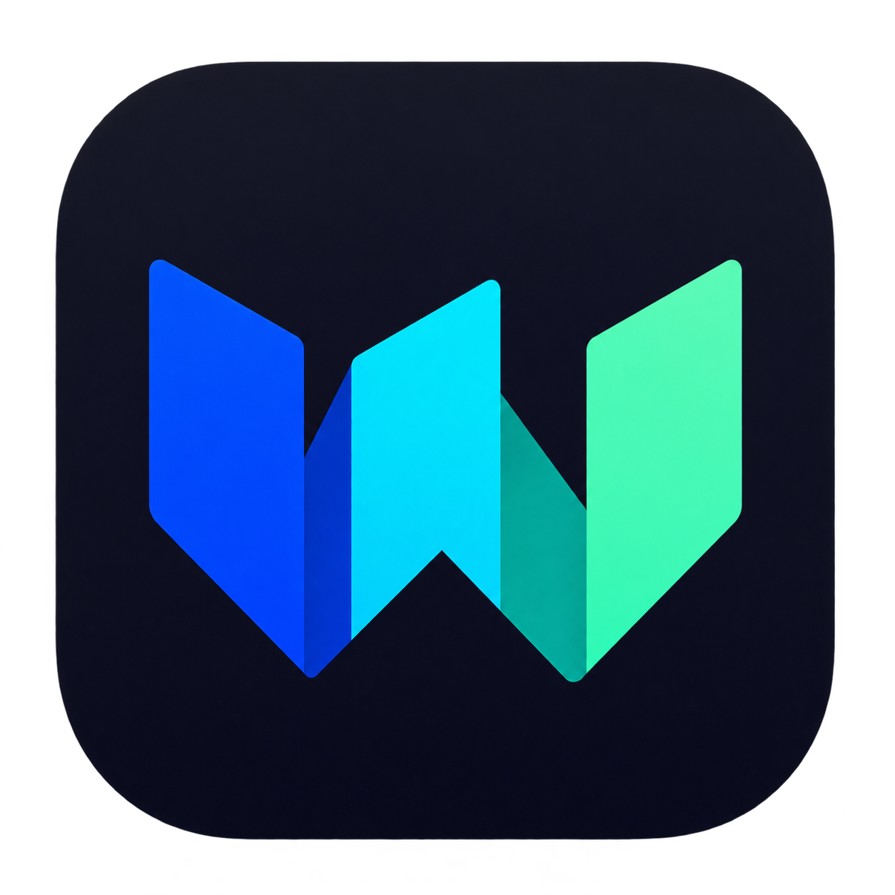
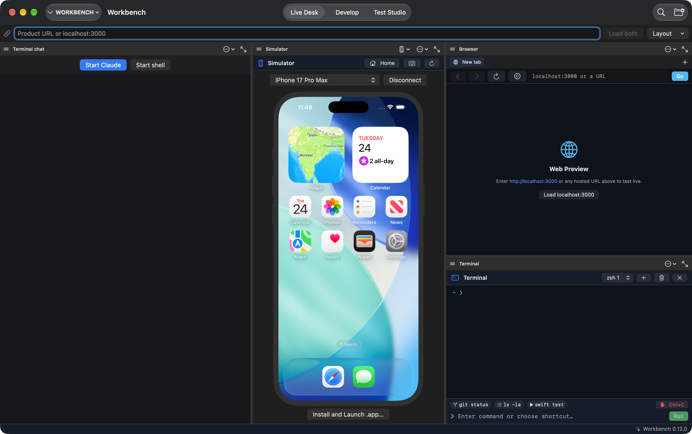

<p align="center">
  
</p>

<h1 align="center">Workbench</h1>

<p align="center">
  <strong>A native macOS workspace for testing your product on web and iOS at the same time.</strong><br>
  Terminal, live iPhone simulator, and browser side by side, with your coding agent one pane away.
</p>

<p align="center">
  <a href="https://github.com/aradhyadengree/workbench/actions/workflows/checks.yml"></a>
  <a href="LICENSE"></a>
  
  
</p>

<p align="center">
  
</p>

## Why Workbench

Shipping a product that runs on the web *and* on iPhone usually means juggling a terminal, Xcode's
Simulator, a browser, and an AI coding session across four windows. Workbench puts them in one
native window that stays in sync: start your dev server, click **Preview**, and the same URL opens
in the desktop browser and the phone at once.

## Features

**Live Desk** is the testing desk you see above:

- **Terminal chat.** A full terminal (xterm.js) on the left. Click **Start Claude** to run Claude Code in your project, or **Start shell** for a login shell.
- **Live iPhone.** Xcode's own simulator display is embedded in the pane, and you can click and drag inside it. Install and launch any simulator `.app`, jump to Home, and capture native-resolution screenshots. You can also switch the phone to **Mobile Web**.
- **Browser.** A tabbed web preview for `localhost` or any hosted URL.
- **Shell.** Multiple shell sessions with one-click shortcuts. When a dev server prints a local URL, a **Preview :port** button appears and loads it into both previews.
- **Flexible layout.** Drag dividers, swap panes by dragging their titles, move panes above, below or beside each other, or expand one pane to fill a laptop screen.

**Develop** is a lightweight editor around the same project:

- File tree with filtering and Git status badges, tabbed editor with syntax highlighting and line numbers
- Quick Open (⌘P), find in file, Git branch in the status bar
- **Claude agent pane**: ask Claude Code about the project and watch its activity (files read, edits, commands) as it works. You choose the model and permission level: *Read only* (default), *Accept edits*, or *Bypass all* (asks for confirmation every launch)
- Independent terminal sessions in any pane

**Test Studio** records a check per platform (web and iPhone), keeps the results per project, and
exports them as a Markdown report with screenshot evidence.

## Requirements

| | |
|---|---|
| macOS | 14 Sonoma or later |
| Build | Swift 5.9+ toolchain (Xcode or Command Line Tools) |
| iPhone pane | Full **Xcode** with an iOS Simulator runtime installed |
| Claude features | [Claude Code](https://claude.com/claude-code) installed and signed in (optional) |

> [!NOTE]
> The embedded iPhone display uses Xcode's **private** CoreSimulator and SimulatorKit frameworks.
> It was developed against Xcode 26.6 on Apple Silicon, and a new Xcode release can break it.
> Everything else works without Xcode. If the simulator pane fails after an Xcode update,
> please [open an issue](https://github.com/aradhyadengree/workbench/issues/new/choose) with your versions.

## Install

### Download

Get `Workbench-<version>-macOS-universal.dmg` from the
[latest release](https://github.com/aradhyadengree/workbench/releases/latest). Open it and drag
**Workbench** into **Applications**. The app runs natively on Apple Silicon and Intel Macs.

Releases are signed with a Developer ID and notarized by Apple, so they open without Gatekeeper warnings.

Workbench is macOS-only. It's built on AppKit and Xcode's iOS Simulator, so there are no Linux
(`.deb`) or Windows (`.exe`) builds.

### Build from source

```sh
git clone https://github.com/aradhyadengree/workbench.git
cd workbench
./scripts/build-app.sh
open Workbench.app
```

The script builds a release binary with Swift Package Manager and packages an ad-hoc-signed
`Workbench.app`. Drag it to `/Applications` to keep it. For quick iteration during development,
`swift run` also works.

## Quick start

1. Click the folder button in the toolbar (or press **⌘O**), choose your project, and stay in **Live Desk**.
2. In the lower terminal, start your dev server (`npm run dev`, `rails s`, …). When it prints a local URL, click **Preview :port** to load it in the browser and on the phone. You can also type an address and click **Load both**.
3. For a native app, choose **iOS Simulator** from the phone pane's target menu, pick a device and click **Connect**. **Install and Launch .app…** accepts any simulator build.
4. In the chat pane, click **Start Claude** and ask it to fix what you see.
5. Open **Test Studio** to record what passed on each platform and export a Markdown report.

## Keyboard shortcuts

| Action | Shortcut | Action | Shortcut |
|---|---|---|---|
| Open folder | ⌘O | Quick Open file | ⌘P |
| New file | ⌘N | Save | ⌘S |
| Close tab | ⌘W | Find in file | ⌘F |
| Next / previous tab | ⇧⌘] / ⇧⌘[ | Focus editor | ⌥⌘F |
| Toggle files pane | ⌘B | Toggle terminal pane | ⌃\` |
| New terminal | ⌃⇧T | Clear terminal | ⌘K |
| Zoom in / out / reset | ⌘+ / ⌘- / ⌘0 | | |

## Privacy

Workbench has no accounts, analytics or telemetry. It only loads the URLs you enter, and it only
runs the shells and `claude` processes you start. Claude Code handles its own sign-in and network
access. Workbench never sees your credentials.

## Project structure

```
Sources/
  Workbench/       SwiftUI + AppKit app: layouts, panes, editor, Test Studio, Claude agent pane
    ChatTerminal/  Bundled xterm.js page for the terminal chat pane
  SimulatorHost/   Objective-C bridge to Xcode's simulator display and input (private frameworks)
  ShellPTY/        Small C library that spawns and resizes pseudo-terminal shells
scripts/           build-app.sh (.app), package-release.sh (DMG + zip), check.sh (CI gate)
assets/            Logo and app icon
```

## Contributing

Contributions are welcome. Bug reports with your macOS and Xcode versions are especially helpful
for the simulator pane. See [CONTRIBUTING.md](CONTRIBUTING.md) to get started, and run
`./scripts/check.sh` before opening a pull request.

## License

Workbench is released under the [MIT License](LICENSE). The bundled xterm.js keeps its
[upstream MIT notice](Sources/Workbench/ChatTerminal/LICENSE).

Workbench is an independent project and is not affiliated with or endorsed by Apple or Anthropic.
Xcode, the iOS Simulator and Claude Code are installed separately and are subject to their own terms.
