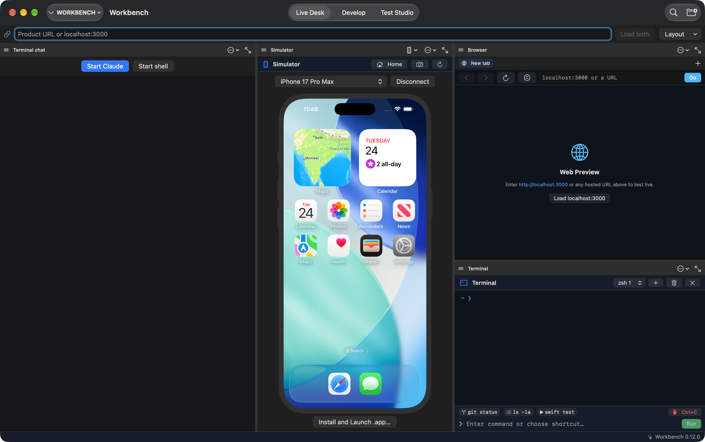

## Workbench 0.12.0: first open-source release

Workbench is a native macOS workspace for testing your product on web and iOS at the same time.
It puts a terminal chat, a live iPhone simulator, a browser, and shells side by side in one window.

### Highlights

- **Live Desk** (formerly Claude Quad): start your dev server, click **Preview :port**, and the same URL loads in the desktop browser and on the phone.
- **Test cases pane**: open your Claude artifact (or any test plan link) in Safari, Chrome or any browser you're signed in to, or right inside the pane. Or paste the cases into a checklist, mark Web and Phone verdicts, and copy the results back as Markdown.
- **Embedded iOS Simulator**: Xcode's own device display, interactive, with install-and-launch for `.app` builds and native-resolution screenshots.
- **A real Claude agent pane** (Develop → Claude): it remembers the conversation, shows every file read, edit and command as it happens, and has a Stop button. You choose the model (Fable, Opus, Sonnet, Haiku, or your CLI default).
- **Safe by default**: the agent starts in *Read only*. *Accept edits* and *Bypass all* are explicit choices, and Bypass asks for confirmation and resets every launch.
- **Test Studio**: record a check per platform and export a Markdown report with screenshots.
- **What's New** sheet, About panel, app icon, and Help menu links.

See the [CHANGELOG](https://github.com/aradhyadengree/workbench/blob/main/CHANGELOG.md) for the full list.

### Download

| File | For |
|---|---|
| `Workbench-0.12.0-macOS-universal.dmg` | Most people. Open it and drag Workbench to Applications |
| `Workbench-0.12.0-macOS-universal.zip` | Scripts and package managers |
| `SHA256SUMS.txt` | Verify with `shasum -a 256 -c SHA256SUMS.txt` |

Both builds run natively on Apple Silicon and Intel and need **macOS 14 or later**.

Signed with Developer ID and notarized by Apple, so it opens without Gatekeeper warnings.

### Requirements

- The iPhone pane needs full **Xcode** with an iOS Simulator runtime. It was developed against Xcode 26.6, and it uses Xcode's private simulator frameworks, so a future Xcode can break it. Please [report it](https://github.com/aradhyadengree/workbench/issues/new/choose) if that happens.
- The Claude features need [Claude Code](https://claude.com/claude-code) installed and signed in.

macOS only: there are no Linux or Windows builds.

Workbench is MIT licensed and isn't affiliated with Apple or Anthropic.
